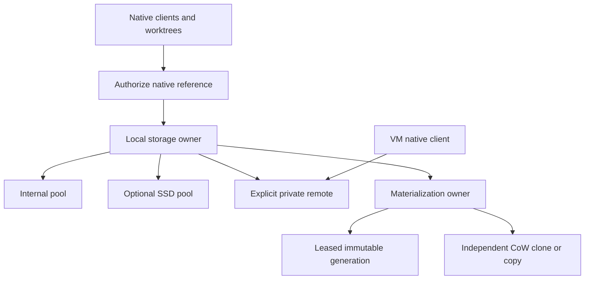

# Personal storage, shared artifacts and safe worktree materialization

Local SSD routing is implemented in source. Wider materialization and peer
storage remain design work. Owners are LayerCache storage, native clients and
CLI. The historical baseline for the original design is
`f7a067447cae955c0a0ff1e0d3aacb945a83b190`.

[TODOs](../TODOs.md) owns priority, milestone state and outstanding work.
[Source research](research/personal-storage-oss-20261023.md) records upstream
revisions, licenses and evidence. This document defines the proposed behavior
and completion criteria, alongside source qualification for local SSD routing.

## Outcome and product decision

Keep a small, useful working set on a laptop, put optional reusable bytes on
storage the user already owns, and avoid repeating compatible computation or
materializing the same immutable data for every worktree.

Internal storage, removable SSDs and explicitly configured self-hosted SSH cache
hosts remain free, account-free OSS. No LayerCache login, subscription or online
entitlement is required to operate those locations. Future manually configured
remote routing remains OSS too. The Local Cache supports optional SSD
routing. The SSH peer workflow remains proposed. Hosted capacity, managed team
administration and automatic host enrollment and coordination are optional
cloud services.

The first target topology is one local owner with internal and optional SSD
pools, plus one explicitly configured private remote. This does not require a
discovery mesh. Preserve cloud-only operation without creating local artifact
storage. Personal, Team and trusted-publisher Public remain access scopes,
independent of physical placement.

| User location | Proposed responsibility |
| --- | --- |
| A laptop's internal disk | Coordinator state and a small bounded hot/offline set |
| Optional removable SSD | Larger optional immutable cache; direct reads while attached |
| One self-hosted cache host | Authenticated remote cache host, storing and producing compatible results |
| A local VM | Independent native client/producer; its disk is not additional physical capacity |
| Optional hosted service | Authorized private capacity and managed sharing; separately qualified Public reads |

An attached SSD expands the warm set and can avoid network fetches or rebuilding.
It need not beat an already-hot internal read. Storage sharing does not schedule
remote execution, launch simulators, or establish cross-platform compatibility.

## Historical baseline and gaps

The following observations refer to the repository baseline above, which includes
separately gated [direct object transfer](direct-object-transfer.md) for hosted
cache bytes. Pool selection must preserve its install and failure contracts,
as described in [Remote reads and direct transfer](#remote-reads-and-direct-transfer).

| Existing behavior | Required change or limit |
| --- | --- |
| Go [artifact.Store](../internal/artifact/store.go) maps native references to SHA-256 blobs, verifies reads, deduplicates equal payloads and protects readers; the daemon already shares artifacts across worktrees of one project | One root per daemon; shared routing and multiple local pools do not exist |
| [Turbo read-through](../internal/server/server.go) and [durable upload queue](../internal/server/uploads.go) connect a Local daemon to one private endpoint and verified Public | Use this complete native path first; multiple private destinations require explicit routing/publication policy |
| [Configuration](../internal/config/config.go) has one `DataDir`, `TeamURL`, `MaxBytes` and `MinFreeBytes` | Changing `DataDir` is not hotplug, migration or an aggregate physical cap |
| [NativeCache](../native/client.ts) has a separate archive cache with a default 5 GiB budget; Expo uses [process-pinned extractions](../native/extractions.ts) | Archives are named by native key plus digest sidecars, not one canonical blob owner; migration/connection must be explicit |
| Native CLI/action restore destinations can be caller-owned | Their output bytes and lifetimes remain separate from managed archive accounting |
| [Graph read leases](../internal/artifact/read_leases.go) protect an exact object set for at most two minutes | A returned filesystem path needs consumer-lifetime protection; ordinary reads do not renew graph leases |
| [Store open](../internal/artifact/store.go) calls `cleanStaging` and `reconcileBlobs` before returning | Establish exclusive pool ownership before opening, including after reconnect |
| [go.mod](../go.mod) pins `golang.org/x/sys v0.49.0` | Reuse its native clone wrappers when qualifying a later materialization adapter |
| [storage inspect](../internal/cli/storage.go) inventories explicit paths without opening a store | It proves neither deletion eligibility nor exclusive/reclaimable allocation |
| [vm-route issue](../internal/cli/vm_route.go) issues short-lived, scoped standalone Turbo/Actions credentials | Useful peer credential seam; it is not host enrollment or instant per-device revocation |
| Gradle/Nx support Local and direct private protocols | Their Local-to-private forwarding remains separate work; Xcode external Swift replay remains unqualified |

The current `artifact.Key` lacks origin/visibility fields because distinct
configuration/store roots supply isolation. Adding an origin field to the
artifact `Key` is an explicit precondition before any owner serves more than
one remote. A shared owner must preserve origin and visibility isolation before
enabling cross-project lookup. Hosted CAS remains project-isolated; local work
does not introduce global hosted deduplication.

## Scope and invariants

Start with closed immutable native artifacts, then explicitly owned expanded
generations. Keep the native client's complete declared inputs and identity.
Physical location, machine name and available RAM/disk do not change native keys.
Target architecture, ABI, OS, SDK and toolchain continue to matter where the
native contract requires them. Equal payload bytes alone do not prove compatible
execution or grant access.

Required invariants:

1. Authorize a complete logical reference before consulting any payload digest.
2. Every writable consumer gets independent inodes; arbitrary writable outputs
   never alias a canonical cached inode through hardlinks.
3. Storage absent at artifact acquisition produces bounded cache fallback. It
   never turns an otherwise runnable native build into a cloud-login or
   SSD-insertion requirement. A path used directly from removable media has a
   separate explicit connected-for-consumer-lifetime contract below.
4. Destination verification and durable commit precede retiring an offloaded
   source replica. No cross-filesystem atomic rename is assumed.
5. Active readers, pending uploads and owned materializations remain charged
   until their bytes can actually be released.
6. A cache acknowledgement, extra replica, pin or successful clone establishes
   no backup or required-handoff retention guarantee.
7. A source-qualified adapter, installed binary, actual workload acceptance and
   hosted deployment are distinct outcomes.

Excluded from the first implementation: arbitrary filesystem migration, active
worktree rewrites, shared mutable `node_modules`/DerivedData/Gradle directories,
moving live VM images, secret or signing-material ingestion, automatic peer
discovery, remote execution, filesystem reformatting and replacing native hashes.
Required pipeline handoffs keep the retained-artifact contract.

## Storage owner and interfaces

Use a deep local storage module behind existing native adapters. Keep local
filesystem and existing authenticated HTTP adapters behind its interface;
native adapters retain archive/graph semantics and compatibility decisions.



Keep coordinator configuration and namespace policy internal. Later relocation
work adds an internal transfer journal. Initially reuse one existing
`artifact.Store` per local pool, including that pool's metadata, staging and
blobs on its filesystem. An internal catalog may
remember SSD references while absent, but those records are availability hints,
not proof of residency. Each pool must be recoverable without an atomic
transaction spanning two filesystems.

The conceptual interface, not an implemented SDK, is:

| Operation | Contract |
| --- | --- |
| Acquire authorized artifact | Resolve complete native reference; return verified stream/handle, source and read lifetime |
| Commit native artifact | Admit capacity, stage and verify; publish an immutable reference in the selected pool |
| Relocate replica | Pin source, reserve destination, copy/verify/commit, then retire eligible source |
| Acquire materialization | Return an owned read-only generation or isolated writable view, method and consumer lifetime |
| Release/recover ownership | Protect live consumers and reconcile abandoned operations conservatively |
| Inspect/plan | Report placement, available sources, ownership, allocation limits and expected fallback without mutation |

This is not a generic filesystem interface. Native tools still request their
normal artifacts and execute their normal commands. Long-lived path consumers
need renewal/release or an explicitly qualified process-lifetime adapter;
the two-minute graph lease cannot be reused for that purpose.
Plan/status output and plan JSON never include presigned URLs or tokens; follow
the [direct-transfer rule](direct-object-transfer.md).

### Identity, ownership and deduplication

Separate three identities:

- **Logical reference:** stable authority/origin, Personal/Team/Public authority,
  project, integration, compatibility profile and the full native coordinates
  including version/ref where required.
- **Content identity:** verified digest and length of immutable bytes, plus the
  native graph closure when applicable.
- **Residency:** pool identity, generation, availability and verified committed
  representation. A host address or mount path is not an artifact key.

Default byte deduplication stays inside an authorized storage scope. One owner
can enforce one aggregate budget while keeping project/authority partitions.
Cross-worktree references within a supported scope may share a blob; duplicate
replicas on separate filesystems each consume capacity. Cross-project physical
deduplication needs a separately qualified policy and cannot expose digest
existence, another project's metadata, or access through a digest-only route.

Coalesce concurrent fetches by complete authorized reference. Once bytes are
verified, deduplicate within the allowed content scope. Cancelling one waiter
must not cancel a fetch still needed by another. Conflicting bytes for the same
immutable reference are a conflict/quarantine event, not last-writer-wins.

One coordinator exclusively owns each local pool. Host and VM communicate over
the cache protocol; they must never open the same live SQLite store. Existing
store open performs staging/orphan cleanup, so ownership must be established
before open, including reconnect and migration.

## Placement, removable SSD and remote policy

Configure read order, local admission and remote publication separately. Initial
defaults: internal hit, attached SSD hit, explicitly configured private remote,
then existing qualified Public lookup where supported. Public resolution keeps
its own identity, signature, expiry and revocation rules. It is not a fallback
that authorizes arbitrary public bytes as private native results.

Keep a bounded internal hot set. While SSD is safely available, admit selected
colder artifacts directly there; otherwise admit within the internal budget or
decline optional cache storage. SSD hits should stream directly, without
mandatory internal promotion. A remote download stages into its selected local
destination. Explicit hot/offline selection can promote artifacts, subject to
budget; it does not guarantee all tools/dependencies needed for offline builds.

Do not publish to every readable destination. Initial remote publication has
one explicit private destination and its existing durable queue policy. Queue
bytes and pins are bounded; outage cannot cause indefinite internal growth.
The user may select remote-only operation independently.
M3 selects one private remote, self-hosted or hosted; simultaneous SSH-plus-hosted
private lookup is deferred until multi-destination precedence/publication is
qualified. Future manual routing stays OSS.

### Remote reads and direct transfer

Remote hits arrive through `TurboClient.Fetch` and then `store.PutVerified`, at
the `server.team.Fetch` call in [the server](../internal/server/server.go).
Choose a local pool at that verified-install seam. With direct transfer, those
bytes may come straight from object storage; pool choice does not change that.

[`Fetch`](../internal/remote/turbo_direct.go) requires install to leave nothing
behind on error. A pool write failure, including an SSD removed mid-install, is
an install error. `Fetch` returns that error unchanged, without a proxied retry
or a failure counted against the direct-transfer circuit breaker. Never publish
a partial entry. Clean accessible staging on failure; leftover staging on a
removed SSD is cleaned when the pool is next opened under exclusive ownership.

The local owner always serves and verifies bytes itself. It never redirects a
client, including stock Turbo, to a pool path, a peer or a presigned URL. The
[server-side stock-Turbo redirect](../qa/turbo-redirect/RESULT.md) is a
hosted-gateway feature only.

### Removable pool lifecycle

Pool states: absent, probing, ready, draining, unavailable and quarantined.

Enrollment records the actual volume identity, an owner-only LayerCache marker,
store generation and supported filesystem capabilities. Volume names and paths
are display/lookup hints. UUIDs identify volumes; they are not authentication.
Unsupported or ambiguous identities require refusal or a separately qualified
adapter, not path-only auto-initialization.

Before opening or writing, verify expected mounted volume, marker, ownership,
exclusive lock and headroom. Hold directory handles and revalidate around
operations to address mount replacement races. Never create a replacement
directory under an absent `/Volumes/...` mount. A renamed mount can be accepted
only after the enrolled identity is verified; replacement/reformat needs new
enrollment. Duplicate identity observations are an explicit error.

On unplug, invalidate readiness, cancel affected cache operations and preserve
the native protocol's failure/fallback behavior. A transfer whose body has
already started may need to fail and restart verification; transparent recovery
is qualified per adapter, not assumed. Do not expose partial restored outputs
as a successful artifact. Reconnect reconciles interrupted staging and
journals under exclusive ownership before serving. Preparing to disconnect can
drain this owner's operations later; it cannot make unplugging an active VM or
another app's SSD data safe.

Replica relocation is journaled:

```text
pin source -> reserve destination -> stage on destination -> verify digest/size
-> flush -> commit destination reference -> record completion
-> release transfer pin -> source eligible for retirement after other leases
```

Crash before destination commit leaves reclaimable staging. Crash after commit
may leave two valid copies. Recovery prefers a recoverable duplicate to loss.
Offloading removes a replica, not every logical reference or every other copy.
Relocation and import preserve metadata byte for byte, including the Turbo
signature tag in [`Metadata.Tag`](../internal/artifact/store.go).
Optional cache content remains rebuildable even when its only cached replica
is on an absent SSD. Required retained data follows its separate contract.

### Free OSS SSH peer and VM access

Use the configured SSH alias and normal host-key/user verification to reach a
user-operated, rootless cache host. Carry the existing authenticated native HTTP
protocol through a tunnel or explicitly protected network endpoint. Do not mount
a remote cache database or invent cross-host SQLite/file synchronization.
Tailscale/SSH connectivity does not itself authorize project reads or writes.

A later bounded helper may mint capabilities bound to the compatibility ID
on the remote side using the existing
[`vm-route issue`](../internal/cli/vm_route.go) model. Keep administrator and
`LocalToken` secrets on the cache host. Initial support is limited to the
qualified native integration; it does not imply a generic credential adapter.
Endpoints have stable authority distinct from a changing tunnel address.

Use explicit deadlines and bounded retries; distinguish unreachable, denied,
expired, corrupt, missing and incompatible. Native computation proceeds when
an optional cache fails, while the native command's actual failure status is
preserved. Do not add tailnet discovery or connect to machines automatically.

Offline authority remains integration-specific. A standalone owner can reuse
their own local scope without a LayerCache account; scoped hosted snapshots
retain their existing fresh authorization requirements. Revocation cannot
recall downloaded bytes or instantly reach a disconnected client. Removing an
SSH key prevents renewal; already issued standalone capabilities can survive
to expiry unless a new revocation registry is separately implemented.

## Sharing expanded data across worktrees

Treat archive reuse, expanded-tree reuse and writable worktree state as separate
representations with separate owners and accounting. Moving packed archives
does not remove output files materialized in each internal checkout.

### Native sharing before another copy

Git already shares repository objects across worktrees; working files, indexes
and generated outputs still have their native lifetimes. pnpm already shares
package content and supports native clone/hardlink/copy policies. Its pinned
10.x global virtual store is an optional future experiment with ESM/CI caveats,
not a reason to share one arbitrary mutable `node_modules`. Moving only a pnpm
store across filesystems turns linking into copies. Gradle dependency caches
have native lock/read-only-seed constraints; host and VM cannot assume one
writable shared cache. Preserve these mechanisms rather than layering another
archive over already shared content. Primary sources and exact pinned behavior
are in the [research note](research/personal-storage-oss-20261023.md).

### Managed immutable expanded generations

When a native consumer explicitly accepts a read-only path, extract once into
an owned immutable generation and return a leased path. Reuse the current Expo
materialization seam where compatible, after qualifying that the consumer does
not sign, instrument, chmod, or otherwise modify the shared baseline. Other
consumers receive independent writable views.

Default long-lived materializations live internally when the workload must
survive SSD disconnection. A read-only path returned directly from SSD is an
explicit opt-in requiring that volume to stay connected for the consumer's
lifetime. A lease protects against GC, not physical removal; an active consumer
can receive I/O errors after unplug, and remote fallback cannot repair its open
path transparently. Do not automatically rerun a native command to hide this
failure. Lazy network/filesystem views have the same mid-execution availability
tradeoff and require their own acceptance.

The expanded representation needs a versioned manifest and materializer policy:
authorized source artifact/graph, normalized relative paths, entry types,
content digests/lengths, executable modes and relevant native metadata. Preserve
the original archive identity; an expanded manifest does not replace its native
key, signature or successful-result evidence. Metadata-sensitive native formats
must be preserved or refused, not silently normalized away.

Reuse existing extraction controls: declared expanded-size/entry limits,
traversal/case-collision refusal and no following destination symlinks. Refuse
hardlink archive entries and unsupported special files. Permit relative symlinks
only under a specifically qualified native policy that cannot escape its owned
generation. Never adopt an arbitrary existing destination tree. Stage, validate
and atomically publish a complete generation; per-file cloning does not make
a live multi-file directory into a consistent snapshot.

One canonical expanded baseline per supported manifest avoids repeated unpacking.
Different archives with identical files may later reuse immutable file content
within the same allowed scope. Byte-equal files with different modes/metadata
cannot simply share a hardlinked inode. Retain original packed bytes only when
needed for native protocol delivery or policy; an expanded copy is additional
allocation until that lifecycle is explicitly qualified.

### Materialization decision

| Consumer/placement | Selected mechanism | Storage claim |
| --- | --- | --- |
| Native client already manages package/object sharing | Native store/link policy | Attribute existing sharing to that client |
| Qualified read-only path consumer | One leased immutable expanded generation | Avoid repeated extraction and consumer copies |
| Writable consumer, same supported filesystem | Independent native CoW clone | Initially shared blocks; later dirty blocks consume space |
| Writable consumer across filesystems or unsupported clone path | Admitted independent copy, or explicit require-clone refusal | Correct isolation; no automatic space-saving claim |
| Daemon-internal immutable aliases with identical metadata | Optional narrowly controlled hardlink | One inode; no writer or mutable-source exposure |
| Arbitrary writable worktree, live mutable source or shared build directory | Refuse hardlink/shared-tree optimization | No safe break-on-write interception exists merely by calling link |

Ordinary `chmod 0444` is not enforced immutability against the file owner. The
owner can change it back; permissions, data and ownership alias through hardlinks.
Existing writable file descriptors/mappings also defeat a read-only-path promise.
Never ingest mutable source files into the canonical store by hardlink. Shared
paths are a qualified trusted-consumer contract, not a same-user security sandbox.
Use clones/copies for uncertain consumers and verify canonical integrity before
reuse; quarantine detected mutation. No daemon-controlled immutable hardlink
may escape into a consumer path that can be modified.

### Native CoW policy

Use existing permissive runtime seams first: the repository's BSD-licensed
`golang.org/x/sys` exposes Darwin clone and Linux ioctl wrappers; pinned Node
supports forced-clone copy flags. A new filesystem dependency is unnecessary
for this narrow adapter. See [source audit](research/personal-storage-oss-20261023.md).

Define policy independently of command spelling:

- `require-clone`: use a native forced clone and refuse unsupported/cross-volume
  placement. No surprise full copy.
- `prefer-clone`: attempt forced clone, then admit an explicit independent copy
  only for a recognized unsupported/cross-device result and sufficient capacity.
- `copy`: independent-file semantics. Report the known mechanism; generic copy
  acceleration may itself share extents, so physical block sharing can be unknown.

APFS cloning requires the same volume; internal-to-external moves copy data.
Linux Btrfs and reflink-enabled XFS require actual source/destination capability
qualification. Ordinary upstream ext4 is copy-only for this design. Do not
swallow permission, collision, quota or I/O errors as unsupported capability.
Apple's best-effort clone flag can silently copy; successful completion alone
does not prove CoW. Record actual per-file clone/copy/mixed outcome and errors.
Native CoW isolates inode metadata and subsequent writes, but does not create
an independent backup or reserve capacity for later divergence.

Keep canonical expanded baselines on each filesystem where enough local reuse
justifies them. For example, an SSD baseline serves read-only SSD consumers,
but an internal writable view needs a transfer; an internal baseline can CoW
into several internal worktree outputs. Retaining both is a measured tradeoff.
File/chunk deduplication of closed generations is a later optional representation;
chunking compressed archives alone must not be assumed effective.

## Capacity, quotas and lifecycle

Account per owner, per representation and per actual capacity domain:

```text
committed packed blobs + expanded baselines + metadata/WAL + staging
+ transfer/migration overlap + reader/upload-held retired bytes
+ owned writable views and permitted divergence + deletion backlog
```

Do not double-count one blob through multiple references. Do charge its actual
replicas on different filesystems. Pool caps and project fairness share one
admission owner per filesystem/capacity domain. Distinct APFS volumes can share
a container, so their available capacity cannot be summed as independent disks.
The VM's guest allocation and outer sparse backing file are separate views of
the same storage, not additive capacity or independent durable replicas.

Reservations cover concurrent staging and expansion before publication. Clone
success can be cheap initially and still fail later with ENOSPC. For managed
writable views, declare an admitted divergence/growth envelope and how it is
enforced. If the filesystem/consumer cannot enforce it, report the bound as
advisory and require full-copy-sized admission for the known baseline; no hard
physical ceiling is claimed for arbitrary subsequent consumer writes. A native
quota/bounded filesystem is required for a hard allocation guarantee. Free-space
checks cannot prevent unrelated processes from filling the filesystem.

Start with existing LRU and explicit hot/offline budgets. Defer predictive
placement and new value heuristics until representative observations justify
them. Leases protect complete native graph closures, pending publication and
live materializations. Preserve process-lifetime behavior where a native API
has no release callback; qualify child processes, PID reuse, crashes and stale
recovery. Unlinked bytes held by readers remain charged until released.

Report apparent size, managed/reference bytes, per-file allocated bytes and
filesystem capacity changes with their measurement limits. Inode-aware totals
handle hardlinks but cannot establish exclusive reflink use. Snapshots can keep
deleted blocks alive. Exclusive/reclaimable bytes remain unknown unless native
evidence supports them; never present uploaded bytes or logical archive size
as reclaimed Mac storage.

## CLI contract and migration

The user journey is inspect -> preview -> explicitly apply owned changes ->
status -> optionally prepare an offline set. Proposed command sketches below
are not current commands or a commitment to final spelling:

```sh
# Existing read-only capability, explicit roots only.
layercache storage inspect --path /selected/workspaces --json

# Proposed commands; not implemented.
layercache storage pool add ssd --path /Volumes/WorkSSD/LayerCache --optional
layercache cache remote add home --via-ssh my-cache-host --read-only
layercache storage plan --goal free-space
layercache storage apply --plan /protected/accepted-plan.json
layercache storage status
```

Plans are bounded, versioned and bound to owner/pool generations. Show eligible
objects, copy versus retirement, expected peak/admission, authority, absent-pool
fallback and unknown reclaimed bytes. Apply revalidates identities, authority,
leases and space; a stale preview never authorizes deleting newly active data.
Use protected credential references outside examples/repositories. Read routes
do not imply publication authority. No full host paths need upload to cloud.
Plan/status output and plan JSON never include presigned URLs or tokens; follow
the [direct-transfer rule](direct-object-transfer.md).

Migrate stopped legacy Go/TS stores by verified resumable import under exclusive
ownership. Do not copy live SQLite files piecemeal, let two old/new owners GC
the same root, or silently rewrite operator configurations. Keep source stores
until verified import and explicit retirement. Record old standalone support
and old-client fallback; never require cloud enrollment to complete migration.
Preserve metadata byte for byte, including the Turbo signature tag in
[`Metadata.Tag`](../internal/artifact/store.go).

Legacy ordinary TS archives contain a non-reversible hash of project/profile/key
and a digest sidecar; they do not record origin/visibility or complete logical
coordinates. Do not bulk-import them under the currently selected backend.
Permit lazy import only when a current authorized reference and trusted original
configuration/provenance establish the old entry's association. Preserve scoped
snapshot origin partitions and fresh authorization. Unattributable entries
produce a cold miss and stay untouched pending explicit retirement; digest
verification alone cannot turn them into a trusted reference. Apply the same
provenance requirement to Go stores whose scope came from their old configuration.

## OSS reuse decisions

[LayerFS](https://layerfs.ai) is explicitly investigated in the
[source audit](research/personal-storage-oss-20261023.md), including its cloned
revision and source/license evidence. It offers shared chunked committed trees
with writable workspace overlays, so it addresses more than byte-identical
whole-file copies. It is a candidate for a bounded Linux workspace experiment.
Current constraints include a Disposable-only Store without crash/power-loss
durability, one Linux-kernel/local-filesystem Store access contract, and no
history GC. It is not the default Mac/SSD/SSH storage adapter.

Prefer native pnpm/uv sharing and the existing Go/Node clone wrappers first.
Investigate a permissive chunk-transfer engine such as desync only if measured
closed-generation transfer/dedup bottlenecks justify another representation.
Linux container snapshotters/lazy image formats can inform a future container
adapter; they do not establish native macOS worktree compatibility. Other
projects' reported benchmarks remain their evidence, not LayerCache savings.

Do not infer permissive embedding from the words open source. Pin selected
source and review the actual dependency graph/licenses, notices, runtime/toolchain
compatibility, maintenance and security before adoption. GPL/LGPL/native system
tools can be research or external-client references without being a permissive
vendored library. This design adds no dependency, copied engine code or daemon.

## Local setup

Set the main quota and enroll a fresh directory on a mounted volume. This
example uses decimal GB and assumes a dedicated RelayPhone config and an unused
local port. Run setup from the repository. Supply the exact Xcode, SDK,
architecture and build-settings compatibility identity you normally use for
compiler caching.

```bash
layercache setup --config "$HOME/.config/layercache/relayphone.json" \
  --project github.com/ziahamza/phone-app --actions-repository relayphone/relay \
  --listen 127.0.0.1:7447 --data-dir "$HOME/.cache/layercache/relayphone" \
  --max-size 5000000000 --min-free-bytes 5368709120 --metro-cache \
  --xcode-socket "$HOME/.cache/layercache/relayphone/xcode/cache.sock" \
  --xcode-compatibility "$RELAYPHONE_XCODE_COMPATIBILITY" --non-interactive

layercache storage enroll-ssd --config "$HOME/.config/layercache/relayphone.json" \
  --mount /Volumes/WorkSSD --directory RelayPhoneCache --max-size 100000000000 \
  --ssd-writes-only

layercache serve --config "$HOME/.config/layercache/relayphone.json"
```

`--ssd-writes-only` keeps internal cache hits readable and sends new artifact
writes to the SSD while it is attached. A full, read-only, or busy enrolled SSD
declines new writes. When the SSD is absent, new writes use the internal quota.
The internal disk still holds cache metadata, including normal read accounting.
`--ssd-only` also bypasses internal artifact lookups while the SSD is available.
With both flags off, the SSD is preferred for new writes and the internal pool
can take writes under SSD pressure. For an existing enrollment, stop the daemon
and run `layercache setup --config … --ssd-writes-only --non-interactive` to
select SSD writes only. Set `--ssd-writes-only=false` to return to the default
policy. Stop a foreground daemon with Ctrl+C. Removing the `ssd` config object
disables routing and leaves both stores on disk.

The daemon verifies the mount boundary, the enrolled directory and the private
marker. On macOS it also verifies the filesystem UUID. Use the same mount path
when reconnecting. A replacement volume requires enrollment. The daemon releases
the SSD handles after an idle interval so the OS can eject the volume. Between
requests, an unavailable SSD falls back to the internal cache. An upload that
loses the SSD after consuming a streamed body can decline caching. A later request
can use the internal cache normally. An in-progress restore can lose its
connection if the SSD disappears after the response starts.

The two quotas cap committed artifact bytes. Local SQLite metadata, transient
staging and client-owned build outputs use additional space. Each pool applies
the free-space reserve to its own filesystem. LayerCache keeps the SSD's index
on the internal disk. Existing cache entries remain where they were created.
Space pressure evicts eligible cold artifacts. Team Turbo publication can
complete an existing queued upload after its artifact's volume returns.

| RelayPhone cache | Entry point |
| --- | --- |
| Turbo task outputs and Expo archives served through Turbo | `layercache run --config … -- turbo run … --cache=remote:rw` uses the daemon without a separate Turbo workspace cache. |
| Gradle task outputs | The native Gradle HTTP endpoint uses the same pool with the existing Gradle init script and scoped credentials from `layercache run`. With that init script, set `LAYER_CACHE_GRADLE_PUSH=1` to populate the pool and `LAYER_CACHE_GRADLE_LOCAL_ENABLED=0` to omit Gradle's separate filesystem task cache. |
| Xcode compiler actions and CAS objects | `layercache xcode run --config … -- xcodebuild …` uses the configured private socket of the running daemon. The daemon checks and retains complete action graphs. |
| Metro transforms | `layercache run --config … -- <Metro or Expo command>` supplies `LAYER_CACHE_METRO_URL` and a scoped `LAYER_CACHE_METRO_TOKEN`. An opted-in Metro config passes them to Metro's native `HttpStore` with a bearer header and treats failed reads as cache misses. |

RelayPhone's `apps/mobile/metro.config.js` selects the shared Metro store when
both credentials are present. An explicit `layercache run --config …` supplies
them for that invocation. For RelayPhone's existing Xcode wrapper, set
`APPLE_XCODE_LAYER_CACHE_CONFIG` to the same config for the invocation.
`APPLE_XCODE_CACHE_CLIENT` can select a source-built binary. Running without
these opt-ins uses the project's regular build entry points.

DerivedData, Metro's default file store, Expo's unpacked app outputs and
TypeScript NativeCache, as well as package installs, CocoaPods, and Gradle's
own dependency and filesystem caches, have independent lifecycles and budgets.
The shared Xcode daemon covers one configured compiler profile and reports
cumulative RPC statistics via `layercache status --json`. Standalone
`xcode run --data-dir …` continues to have its own lifecycle and per-run receipt.

## Local qualification

The strict write policy passed repeated race-enabled APFS tests using the
same pool across attach, forced detach and reconnect. The test holds an SSD
read and a streaming upload open at forced detach. It verifies that the
interrupted upload leaves no visible entry, that a detached write reaches
the internal pool, and that the old SSD entry and a complete upload retry
work after reconnect. It also verifies that a busy or over-quota SSD causes
write refusal while a previously cached Mac entry remains readable.

The live RelayPhone daemon was switched to this mode with its 5 GB internal
and 100 GB SSD quotas. An existing XCR input from the internal cache matched
its stored digest while the physical SSD was attached. A new probe increased
SSD usage by exactly the probe size and left internal artifact usage unchanged.

With SSD-only mode enabled on the RelayPhone Mac, a foreground run of the
source build verified that two XCR test-input fixtures landed on its physical
APFS USB drive and were reused across separate upstream object keys. Internal
artifact usage stayed at zero during the check.

The installed Mac XCR worker was then enabled against the running Local Cache.
During a warm XCR input restore, the actual USB SSD's APFS volume was
force-unmounted after 32 KiB reached the output file. The real cache connection
terminated before the complete artifact arrived. XCR recovered a 32 MiB ZIP in
one production R2 GET and verified its SHA-256. With the volume still unavailable,
the next restore hit the internal cache. LayerCache detected the original
volume again after remount. The USB cable stayed connected throughout the test.

On November 25, 2026, a source build from the workspace based on
`94888b32ebcdfe27c45f07eef9159060c9ea8c74` ran on macOS 27.2 and disposable APFS
disk images. The primary fixture used 5,000,000,000 internal bytes and
100,000,000,000 SSD bytes. These were configuration limits, with fixture
artifacts small enough to run on the test images.

- Turborepo 2.10.12 restored the same output on the original volume, restored
  independently from the internal cache while detached, and found the original
  volume's entry again after reconnect. SSD-only mode hid an internal artifact
  while attached. A forced detach during an upload returned HTTP 507. The key
  missed on both stores and reconnect cleared the interrupted staging.
- Tiny 64-byte and 128-byte quotas exercised independent eviction. The default
  policy kept reading a warm internal hit after attachment. A second APFS
  volume at the same mount path was refused despite a copied enrollment marker.
- Gradle 9.4.1 restored a cacheable task through native HTTP on both volumes,
  with its own filesystem build cache disabled. A queued Turbo upload reached
  an embedded Team endpoint after daemon restart and SSD reconnect.
- Xcode 27.2, build 27B52, compiled and ran a Swift and Objective-C fixture.
  The warm shared-cache run reported 69 action hits and 119 CAS object hits.
  A detached cold build wrote compiler artifacts to the internal pool. The
  opt-in RelayPhone wrapper restored compiler results through its shared socket.
- The project's Metro configuration resolved the installed Metro 0.87.1
  HttpStore through Expo SDK 58 and restored a transform through LayerCache.
  A RelayPhone web export published 3,248 transform entries (10,262,862
  committed bytes). Its outputs matched a cache-bypassed export after
  normalizing CSS-module property order and the corresponding bundle filename.

The Go suite passed with test stores on a dedicated APFS image. The repository
lint and RelayPhone's existing Xcode-wrapper test passed. A full RelayPhone iOS
build and an installed LayerCache release remain separate checks.

### Standalone Xcode archive qualification

On November 26, a disposable build of LayerCache main
[`8c26107`](https://github.com/layercompute/layercache/commit/8c2610750a7b730a23644d83fd530190aca5f6dc)
ran `layercache xcode run --config … -- xcodebuild …` for a standalone Swift CLI
project, Release arm64 on Xcode 27.2 (27B52), macOS SDK 26B118. Deleting the
entire DerivedData directory, including Xcode's native CAS, still yielded three
of three compiler hits and a byte-identical executable. Main CI for this source
also passed the force-unmount fixture. [Main CI](https://github.com/layercompute/layercache/actions/runs/45712413743)

The same disposable daemon accepted an already-packed 11,631,321-byte archive
through its authenticated loopback `/v8/artifacts` endpoint. With the enrolled
APFS image detached, a PUT and GET verified exact bytes from internal storage.
With the image attached under the 5 GB internal and 100 GB SSD strict write
policy, a second key stored its blob on the SSD. Removing the image caused that
key to miss while the internal copy still hit. Reattaching the enrolled image
restored the exact SSD bytes.

A second archive created with macOS `tar --format pax` preserved the built
executable's SHA-256 and nanosecond mtime across an authenticated Local Cache
round trip. After extraction, Xcode produced zero `SwiftCompile` entries. The
earlier archive created with Python `tarfile` also arrived byte-for-byte and
preserved the explicit timestamp marker. That restored build ran one Swift
task, which hit the compiler cache. Retain the producer's qualified archive
format and verify actual Xcode build behavior as well as the transfer digest.

The PAX sample was 9,871,639 bytes. Single elapsed observations were 6.240 s to
pack, 0.100 s for the loopback PUT and GET, and 0.505 s to extract. The intact
warm build took 6.195 s and the restored warm build took 3.599 s. The Mac shared
resources with other work. These observations establish local functionality.
Fresh-host R2 timing, peak allocated disk and a representative application
comparison remain open. The archive experiment used the existing opaque byte
interface. The live, writable DerivedData directory remained caller-owned.

## Milestones and acceptance

[TODOs](../TODOs.md) tracks qualification and remaining runtime work. M0 records
design research. The broader milestones below describe later work and its
proposed evidence. M2–M5 are designed in turn after
the preceding slice has shipped and been used. Each runtime milestone needs
source qualification, a verified installed release and actual workload
acceptance separately; hosted rollout adds another receipt where relevant.

| Milestone | Owner and dependency | Completion target |
| --- | --- | --- |
| M0: design/source audit | Product + storage/native; this documentation change | Record current source, upstream revisions/licenses, OSS policy, unsupported behavior, interfaces and acceptance; no runtime savings/adoption claim |
| M1: one bounded local owner through Turbo | Storage/native; M0 | The Go daemon already shares artifacts across worktrees of one project; bring TypeScript NativeCache under the same owner and budget, preserve scoped references and qualify safe migration |
| M2: optional SSD pool | Storage/CLI; M1 lifecycle/accounting | Verified enrollment/offload/direct reads, graceful absence/reconnect, and sustained measured reduction in internal allocation |
| M3: one free OSS SSH peer + VM client | CLI/auth/native; M1, M2 when needed for SSD-backed VM | Exact compatible producer/consumer reuse without LayerCache signup; scoped credentials, bounded fallback and honest physical accounting |
| M4: immutable expanded generations and native CoW | Materialization/native owner; M1 plus measured extraction/copy bottleneck | One leased read-only baseline or independent clone/copy per writer, with write isolation and demonstrated net footprint/time tradeoff |
| M5: conditional OSS workspace-engine experiment | Storage/native research; M4 evidence and explicit workload | Decide whether a pinned engine adds enough value under platform, durability, GC/quota, semantics and license gates; adopt none by default |

The later SSH slice can qualify an independent remote host without extending
removable-storage behavior. Gradle forwarding follows the complete Turbo path.
Other native adapters, automatic managed coordination and trusted Public
production keep their own acceptance gates; they cannot be closed by a generic
storage fixture.

### M1-M3 qualification matrix

| Control | Required evidence |
| --- | --- |
| Native correctness | Independent empty consumer restores equivalent outputs; changed input/profile/toolchain/target misses; actual assertions/status retained |
| Scope isolation | Same project/native key under another origin or authority cannot resolve data; digest possession grants no access; no private-to-Public promotion |
| Dedup/concurrency | Equal authorized payloads deduplicate within declared scope; concurrent worktrees single-fetch; one cancelled waiter does not harm others |
| Corruption/failure | Reject partial/corrupt bytes and incomplete native graphs; interrupted publication never becomes a hit |
| Capacity/leases | Include staging, metadata, readers, upload pins and migration overlap; concurrent quota pressure refuses safely; active-reader GC remains correct |
| SSD identity | Absent startup, renamed mount, replacement at same path, reformat/duplicate marker, read-only/full volume and writable underlying mountpoint |
| SSD interruption | Remove during lookup, verification, transfer, commit and read; reconnect/restart recovers without publishing partial results or internal mountpoint spill |
| Remote authority | Read-only and writer roles, expired/known-revoked capability, SSH host identity change, slow/offline peer and cancelled transfers; documented revocation limits |
| VM ownership | Host/VM cannot own one pool concurrently; compatible native reuse proven rather than assumed from repository name |
| Lifecycle/migration | Preserve metadata byte for byte, including the Turbo signature tag in `Metadata.Tag`; crash at every transfer/import phase; rollback preserves legacy source; unattributable hash-only archives cold-miss, scoped snapshot origin/auth preserved; old config and remote-only behavior retained |
| Standalone availability | Internal, SSD and one peer operate without cloud account; absent optional cache preserves native build usability and native failure status |

### M4-M5 qualification matrix

| Control | Required evidence |
| --- | --- |
| Expanded identity | Safe manifest/metadata policy, bounds, case collisions, traversal/symlinks and special-file refusal; no live-directory snapshot assumption |
| Shared-path lifetime | Two declared read-only consumers reuse one generation; live/child consumers, cancellation, process exit, PID reuse and restart do not cause premature GC; direct SSD paths opt into a connected lifetime and removal surfaces explicit failure |
| Write isolation | Write, truncate, writable mmap, chmod/xattr, rename/delete and source-replacement attempts leave canonical tree and other consumers intact |
| Hardlink refusal | Reject writable output aliases and mutable-source ingestion; changing read-only bits or using an existing writer cannot corrupt the canonical baseline |
| Clone truth | Actual APFS/Btrfs/XFS pairs qualified; distinct inode/metadata and supported clone outcome recorded; ext4/cross-volume require-clone refusal explicit |
| Fallback/admission | Unsupported clone may copy only under policy and fresh reservation; permission/quota/I/O failures preserved; mixed-tree outcomes reported |
| Divergence/ENOSPC | Concurrent dirty clones and growth bounded as declared; later low-space failure preserves baseline and surfaces native failure; snapshots do not produce false reclaimed bytes |
| Whole-operation benefit | Include extraction, clone/copy, verification, cleanup, packed/expanded baselines and dirty deltas; retain slower or larger observations |
| Engine-specific gate | Pin source/dependencies; qualify native semantics, storage limits/GC, durability/recovery, mount/unmount, auth separation and platform; unsupported capability is an explicit no-go |

### Measurement and go/no-go

First choose one real workload and record its source/native profile, internal
filesystem, SSD capability, network and existing native-cache policy. No user
device inventory or baseline was gathered for this design. Numerical capacities
and acceptable regression envelopes are chosen from that evidence before the
runtime pilot, not invented as savings targets here.

Compare equivalent internal-only native-warm, fresh-output, first offload,
SSD-connected repeat, SSD-absent, peer-connected and peer-outage operations.
Use the [complete-operation recorder](operation-measurement.md) where practical:
prepare/authenticate, restore, native work, close and publication. Report migration
and bootstrap separately; never trigger extra application builds just to fill
charts. Retain negative observations, sample spread and unmatched contexts.

Acceptance needs equivalent outputs/status and safe recovery first, then
sustained positive net internal allocation reduction across repeated sessions.
Measure peak internal/SSD/host headroom and total physical footprint separately
from internal reclamation. A storage improvement with slower full commands must
be reported as a measured tradeoff; claim a speedup only for a matched observed
comparison. No hit-count-derived CPU, price, portability, backup or fleet-wide
savings claims. Independent review and normal required repository checks precede
implementation delivery; no runtime tests or hardware trials belong to M0.
